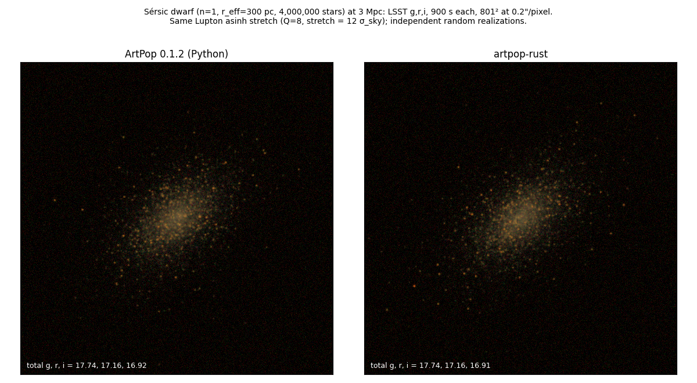
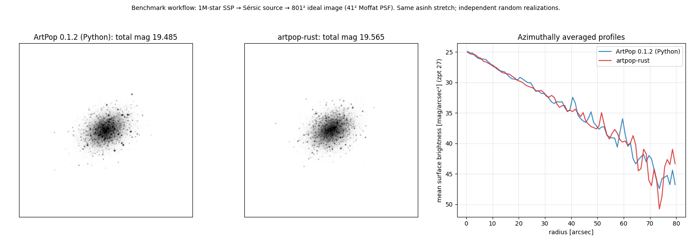
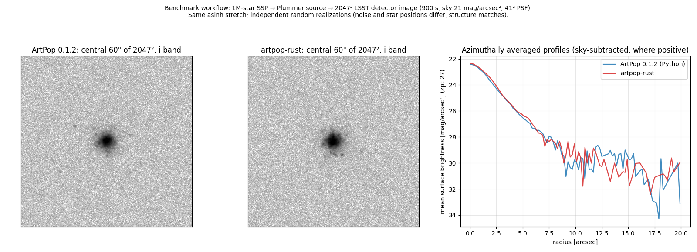

# artpop-rust

A Rust port of [ArtPop](https://github.com/ArtificialStellarPopulations/ArtPop) 0.1.2 (commit [`38a8869`](https://github.com/ArtificialStellarPopulations/ArtPop/commit/38a886906ed175d0205bf48b6dc03f54aeb4a81a)). It builds artificial stellar populations and mock images, and exposes every capability through one typed operation registry. That registry is served by a command-line interface (`artpop-rust`) and by an MCP server (`artpop-rust mcp serve`) for agents. Scientific code is Rust only; the single native dependency is CFITSIO for FITS, vendored and statically linked. There is no Python runtime.

**Status:** all 68 operations in the [CLI/MCP contract](docs/CLI_MCP_CONTRACT.md) are implemented and covered by tests. Parity with ArtPop and performance were measured against the built binary; see [Implementation status](docs/IMPLEMENTATION_STATUS.md) and [Benchmark results](docs/BENCHMARK_RESULTS.md).

## Quick start

```bash
cargo build --release                      # needs Rust 1.99, a C/C++ compiler, CMake >= 3.5
B=./target/release/artpop-rust

$B operations                               # the 68 operations and their MCP tool names
$B system schema --operation population.build --pretty

# Import the bundled test isochrone, sample a population, place it, and observe it.
ISO=$($B isochrone import --input examples/isochrone-import.json --get /result/isochrone_artifact_id)
POP=$($B population build --input examples/population.json --set isochrone.artifact_id=$ISO \
        --seed 000000000000002a --get /result/population_artifact_id)
$B population photometry --set artifact_id=$POP --format text
$B simulate run --input examples/simulate-artificial.json --set population.isochrone.artifact_id=$ISO \
        --set outputs.directory=out --format text          # FITS planes + PNG previews in ./out

examples/run.sh                              # the same chain as a script

# MCP over stdio (file access confined to the artifact/data directories and --allow-path roots)
$B mcp serve --artifact-dir ./artifacts --data-dir ./models

# MIST grids are explicit data: fetch (verified, atomically published) or register a local copy.
$B data fetch --set photometric_system=LSST --data-dir ./models
```

Every command prints one JSON result envelope on stdout (`--format text` for a human summary). Diagnostics go to stderr. Exit codes are 0 for success, 2 for validation errors, 3 for missing data, 4 for resource limits, 5 for I/O or network errors, 6 for numerical failures, 7 for job conflicts, and 130 for cancellation. Producing operations return content-addressed artifact IDs (`sha256:…`) that later requests reference; files are written only by `artifact.export` and `simulate.run`. Stochastic operations require `execution.seed` (16 hex digits), and identical requests yield identical artifacts. MIST grids are never downloaded implicitly. Register one with `data import` or fetch it with `data fetch`; every read of a registered file is digest-verified. See [examples/](examples/) for complete requests.

## Verification

- **Rust tests:** 97, covering unit, deviation-regression, workflow, coverage, CLI, and MCP-client tests (`cargo test --workspace`). Each of the 68 operations is exercised directly. Unit tests also pin the FITS encoder to CFITSIO's bytes and the parallel histogram, sums, samplers, and CSV parser to their sequential forms.
- **Python reference comparisons:** 36 tests (`validation/`, run with `--require-rust`). These are the 5 original end-to-end workflows (histogram exactly equal, ideal image to 1.1e-15 relative L1, statistical noise, population, and grid checks), 4 comparator self-tests, and 27 extended checks: IMFs, isochrone integrals against a 50-digit oracle, magnitude limits and inversion, all SciPy interpolation kinds, all four PSF modes, wrap/fill convolution, smooth amplitudes, detector conversions, 164 filters and zero points, MIST selection bit-for-bit, and sampler statistics.
- **MIST data:** a live `data.fetch` from mist.science reproduced the analysis grid byte for byte. MIST isochrones (on- and off-grid [Fe/H]) match ArtPop's `MISTIsochrone` exactly.
- **Deliberate differences** from ArtPop (corrected defects, documented options) are listed with their regression tests in [IMPLEMENTATION_STATUS.md](docs/IMPLEMENTATION_STATUS.md#deliberate-differences-from-artpop-012-rust-v1).

## Performance

These are fresh-process workflow timings on a 4-vCPU AMD EPYC 7B13 VM. Rust times include the CLI calls, artifact storage, and the Python adapter process that drives them (about 0.04 s). Full methodology, raw samples, RSS, and the per-operation breakdown of two optimization rounds are in [BENCHMARK_RESULTS.md](docs/BENCHMARK_RESULTS.md).

| Workflow | ArtPop 0.1.2 (Python) | artpop-rust | Speedup |
| --- | ---: | ---: | ---: |
| Catalog (100k) → count histogram → FITS | 1.27 s | 0.074 s | 17.2× |
| Catalog (100k) → Moffat PSF → ideal image → FITS | 1.30 s | 0.095 s | 13.8× |
| Catalog (100k) → detector noise → three FITS planes | 1.30 s | 0.105 s | 12.4× |
| Isochrone → 100k-star SSP → CSV + photometry | 1.54 s | 0.117 s | 13.2× |
| 7×7 weights → 100k positions → CSV | 1.36 s | 0.073 s | 18.5× |
| 1M-star SSP → photometry | 1.69 s | 0.154 s | 11.0× |
| 1M-star SSP → Sérsic source → 801² ideal image (41² PSF) → FITS | 2.11 s | 0.311 s | 6.8× |
| 1M-star SSP → Plummer source → 2047² detector image (41² PSF) → 3 FITS planes | 3.94 s | 0.661 s | 6.0× |
| 10M uniform positions → 2047² histogram → FITS | 1.84 s | 0.510 s | 3.6× |
| MIST LSST 10 Gyr, 1e7 Msun, cutoff 29 mag → photometry | 2.30 s | 0.185 s | 12.4× |
| MIST LSST 10 Gyr, 1e7 Msun fully sampled (2.3e7 stars) → photometry | 21.36 s | 3.300 s | 6.5× |

The geometric-mean speedup is 9.9×, and peak memory was lower for Rust in every workflow. At 100k stars, most of ArtPop's time is its roughly 1.2 s of imports, so those rows mostly measure startup. The scale rows show compute and I/O costs. The last row is the compute-bound reference: without a magnitude cutoff ArtPop draws 2.3e7 stars and interpolates nine columns for each, which takes it 20 s; Rust spends 2.2 s building (half of it content-hashing and writing 2.2 GB of columns) that population and 0.6 s on its photometry.

## Side by side

Equivalent galaxies from ArtPop 0.1.2 and artpop-rust, each pair shown with one display stretch. The two backends draw independent random realizations (rust-v1 has its own random streams), so individual stars and noise differ while the structure, totals, and profiles agree. Generated by [`tools/side_by_side.py`](tools/side_by_side.py) from the benchmark outputs plus a new three-band run.



A Sérsic dwarf (n = 1, r_eff = 300 pc, 4 million stars) at 3 Mpc in LSST g, r, i with 900 s exposures and detector noise, composed with identical Lupton asinh parameters. Total magnitudes agree to 0.01 mag.





```bash
python tools/side_by_side.py --rust-bin target/release/artpop-rust --out-dir docs/images --scale-dir /path/to/scale-benchmark-work-dir
```

## Documents

1. [Implementation status](docs/IMPLEMENTATION_STATUS.md): operations, tests, deviation ledger, known limitations.
2. [Benchmark results](docs/BENCHMARK_RESULTS.md), and the earlier [Python baseline](docs/BENCHMARK_BASELINE.md).
3. [Upstream analysis](docs/UPSTREAM_ANALYSIS.md): algorithms, data, verified upstream defects.
4. [Rust port specification](docs/RUST_PORT_SPEC.md) and [CLI/MCP contract](docs/CLI_MCP_CONTRACT.md): the design this implementation follows.
5. [API coverage ledger](docs/API_COVERAGE.md): 172 upstream declarations mapped to operations.
6. [Validation plan](docs/VALIDATION_PLAN.md) and [validation tools](validation/README.md).

## Layout

```text
crates/artpop-core     scientific engine (no I/O)          crates/artpop-service  operations, schemas, artifacts, jobs
crates/artpop-io       CSV, FITS (CFITSIO), PNG, SVG        crates/artpop-mcp      MCP server (official rmcp SDK)
crates/artpop-cli      the artpop-rust binary              data/ fixtures/        converted bundled metadata, test isochrone
validation/            Python reference harness and benchmarks (development only)
analysis/ tools/       analysis probes and the bundled-data converter (development only)
```

## License

artpop-rust is licensed under the [Apache License 2.0](LICENSE). The bundled filter metadata, zero points, and test isochrone are converted from ArtPop, which is MIT-licensed; ArtPop's copyright notice ([LICENSE-ArtPop](LICENSE-ArtPop)) applies to those files. MIST model data are distributed by the MIST project under its own terms and are not bundled.
