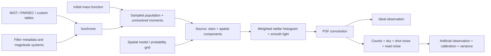

# Deep analysis of ArtPop 0.1.2

Analysis date: 2026-10-12. Reference: [commit 38a8869](https://github.com/ArtificialStellarPopulations/ArtPop/tree/38a886906ed175d0205bf48b6dc03f54aeb4a81a). Paths and line references below refer to that checkout. The [API ledger](API_COVERAGE.md) links individual declarations to immutable upstream source.

## 1. What the library actually does

ArtPop turns stellar-evolution tables into discrete stellar populations, places those stars in a spatial distribution, and makes ideal or noisy astronomical images. Its organizing objects are **population**, **source**, **imager**, and **observation**. A source combines a population's photometry with positions; an imager supplies the instrument model.

It does not solve stellar structure or evolve stars itself. MIST supplies precomputed stellar evolution and synthetic photometry. PARSEC tables and user-provided isochrones are also supported. Reimplementing MESA, a spectral synthesis engine, atmospheric models, or the MIST web interpolator would exceed this port's scope.

The important optimization is a hybrid representation: sample bright stars individually and represent faint stars as integrated light. This affects total mass, total flux, surface-brightness fluctuations (SBF), source morphology, and image construction. A port that renders only sampled stars would lose functionality and change the science.

## 2. Repository scope and dependencies

The checkout contains **17 Python source files / 5,038 physical lines**, including docstrings, and five test modules containing 18 test methods. Six documentation notebooks cover quickstart, artificial images, injection into existing images, populations, sources, and spatial sampling. `colab_tutorials/` supplies parallel notebook examples.

| Area | Files | Responsibilities |
| --- | --- | --- |
| Initial mass functions | `stars/imf.py` | Kroupa, Salpeter, Scalo, custom power laws; integrals, weights, count/mass sampling |
| Evolution tables | `stars/isochrones.py`, `stars/_read_mist_models.py` | Custom and PARSEC import; MIST parsing, age selection, metallicity interpolation; population integrals |
| Stellar populations | `stars/populations.py` | SSP construction, remnants, extinction, unresolved light, photometry, composition, phases |
| Spatial distributions | `space/sample.py`, `space/models.py` | Discrete weighted-grid, Sérsic, Plummer, uniform sampling; model evaluation |
| Sources | `source.py` | Position/magnitude catalogs, labels, source constructors and composition, smooth amplitudes |
| Imaging | `image/imager.py`, `image/psf.py` | Pixel deposition, PSFs, FFT convolution, ideal/artificial observing, noise and calibration |
| Filters | `filters.py`, `data/`, `filter_curves/` | Filter lists/properties, custom curves, AB/Vega/ST offsets |
| Utilities | `util.py`, `visualization.py`, `log.py` | Units, RNG handling, geometry, downloads, display, logging |

`setup.py` declares NumPy, SciPy, Astropy, Matplotlib, fast-histogram, and requests. There is no existing CLI, MCP server, task scheduler, persistent artifact service, or typed wire schema. Most top-level exports come from wildcard imports; utilities remain available through `artpop.util`. Base-class methods matter even when the base itself is not in `__all__`.

The six dependencies do substantial work: interpolation and special functions, table representation and physical units, random distributions, PSF discretization, FITS writing, FFT convolution, and image display. Replacing imports with similarly named Rust crates is insufficient without matching these semantics.

CI runs pytest on Linux/macOS/Windows with Python 3.8–3.10. The suite has strong numerical reference points for a few nominal cases, but limited edge coverage. Many features have no direct tests, including custom filter curves, PARSEC, source composition, faint-star photometry, and non-square histogram boundaries.

## 3. Data assets and model selection

Verified from the bundled metadata and filesystem:

| Photometric system | Filters |
| --- | ---: |
| HST_WFC3 | 57 |
| HST_ACSWF | 13 |
| SDSSugriz | 5 |
| CFHTugriz | 6 |
| DECam | 6 |
| HSC | 7 |
| JWST | 29 |
| LSST | 6 |
| UBVRIplus | 21 |
| UKIDSS | 5 |
| WFIRST | 7 |
| GALEX | 2 |
| **Total** | **164** |

There are 164 precomputed filter-property rows and 164 curve CSVs. The curves occupy about 21 MB decimal. Five bundled data files occupy 227,322 bytes: three metadata pickles, `zeropoints.txt`, and a 1,467-row LSST test isochrone pickle. The latter includes initial/current masses, EEP, temperatures, luminosities, six LSST magnitudes, and phase metadata. CSV curves have a header; custom `FilterSystem` callers must supply the appropriate delimiter/skip options.

The Python installation's package-data declaration includes the pickles and text data, while the curve directory is at repository root. The port should deliberately package/version the curves rather than infer their availability from the metadata package.

MIST access is fixed to **v1.2**, alpha enhancement 0.0, and rotation 0.4 by default, with 0.0 also supported. The metallicity grid is −3.0, −2.5, then −2.0 through +0.5 in 0.25 steps. Age selection is nearest neighbor on a nominal log10(years) grid from 5.0 to 10.3 in 0.05 steps. The observed NumPy grid has 107 points and a maximum of `10.299999999999981`; literal `10.3` can fail the range check. Treat integer grid indices as authoritative in Rust.

Off-grid metallicity is interpolated linearly in the table columns. If adjacent isochrones have different lengths, the shorter one is extended using the other table's tail increments before interpolation. This is a specific algorithm to reproduce and validate; it is not a generic two-dimensional age/metallicity interpolator. Multiple photometric systems are appended by row position without strong alignment checks.

The live MIST site now presents both v1.2 and v2.5 and labels the old WFIRST filters as a 2018 preliminary set. Keep the v1.2 tables and identifiers for parity; adding newer grids is a separate, versioned capability. Its LSST v1.2 rotation-0.4 archive is listed as 76 MB. The extracted LSST cache used for this analysis occupied about 558 MiB. [MIST model catalog](https://mist.science/model_grids.html)

The downloader uses a hard-coded HTTP URL, writes an archive, extracts it, and deletes the archive. It does not verify a checksum or response status, and the directory's existence is treated as proof of completion. These are significant reliability issues for agent retries and interrupted runs. Importing ArtPop can also create cache directories and print a warning to stdout. Rust initialization must be explicit and protocol-clean.

## 4. Numerical pipeline in detail

### 4.1 Initial mass functions

The code represents a continuous three-segment power law. Kroupa slopes are −0.3, −1.3, −2.3 with breaks at 0.08 and 0.5 solar masses. Scalo uses −1.2, −2.7, −2.3 and breaks at 1 and 10. Salpeter is a single −2.35 slope implemented through repeated slopes and artificial high-mass breaks. Raw normalization therefore has an implementation-specific scale; normalized probabilities and raw `weights()` must be considered separately.

`IMFIntegrator` computes number and mass integrals analytically, despite its class description saying numerically. It supplies raw, sum-, number-, and mass-normalized weights. The implementation divides by `a+1` or `a+2`; custom slopes −1 and −2 trigger division by zero. Rust needs logarithmic limiting branches and a stable continuity construction that also supports a zero slope.

`sample_imf` constructs 100,000 logarithmic **edges**, evaluates 99,999 arithmetic midpoints, accumulates `weight * bin_width`, normalizes the CDF, and linearly interpolates its inverse. The CDF starts at the first bin's positive probability; samples below that value receive `m_min`. Replacing this with an exact inverse changes the distribution slightly. Preserve the discretized option for reference comparisons and expose exact inversion separately.

`build_galaxy` adds whole batches until initial sampled mass exceeds the requested mass. It retains the final entire batch. The maximum overshoot depends on batch size and sampled masses; this is not a strict relative-error guarantee. Repeated concatenation reallocates accumulated catalogs. A Rust implementation can reuse capacity and a cached CDF while preserving a selectable stopping policy.

### 4.2 Isochrone operations

`Isochrone` requires nondecreasing initial mass, current mass, and per-filter magnitudes; EEP, log luminosity, and log temperature are optional. It does not comprehensively validate lengths, finite values, or duplicate masses.

It supports interpolation between arbitrary named columns, mass-bin IMF weights, nearest mass, theoretical integrated magnitude/color/SBF, mean current stellar mass, and surviving mass. `mag_to_mass` searches all crossings of a generally nonmonotonic magnitude–mass curve. Returning only one root would lose real behavior. Magnitude limits can be derived from a sampled number or mass fraction.

The isochrone weights integrate the IMF over midpoint-defined initial-mass cells. End cells use the configured lower normalization limit and final table mass. Surviving mass includes current luminous masses and optional remnants: black holes receive half their initial mass above 40 solar masses, neutron stars 1.4 solar masses from 8.5–40, and white dwarfs `0.48 + 0.077 * initial_mass` below 8.5, where stars have evolved beyond the live table. These limits are configurable. Integration intervals must be clipped to actual normalization bounds; upstream does not always do that.

PARSEC import discovers a header containing `Zini`, selects log age and initial metallicity using small absolute tolerances, and identifies filter columns after `mbolmag` unless their count is given. This is table import, not a PARSEC data downloader.

### 4.3 Populations and unresolved light

An SSP is created by a star count or total current stellar mass. The count path samples live initial masses and interpolates current masses/magnitudes. The mass path estimates initial mass needed from mass loss, remnants, and the fraction sampled, then calls the batch sampler. `SSP` defaults to mass tolerance 0.01; `MISTSSP` defaults to 0.05, and several source wrappers use 0.01. A shared Rust request must eliminate accidental default differences or record an explicit upstream preset.

With a magnitude limit, the algorithm finds the smallest crossing mass, integrates the sampled fractions, samples above that mass, and transfers evolved stars that are still too faint into the integrated component. It computes both first flux moments and second flux moments. SBF is proportional to `sum(flux²) / sum(flux)`, so retaining only total integrated flux is inadequate.

Distance affects apparent magnitudes through the distance modulus. Extinction is an additive scalar or per-band magnitude vector. It is a supplied attenuation, not an extinction-law solver. Selection-aware photometry includes the integrated component only when no discrete-star selection is supplied. `total_initial_live_mass` is the sum of sampled initial masses, not a complete reconstructed formation mass; Rust result names should make that distinction explicit.

Population composition concatenates catalogs and combines mass and integrated-light bookkeeping. Upstream requires identical filters and distance, drops extinction with a warning, can mishandle an integrated right-hand operand, mutates some metadata on the right-hand operand, and collapses incoming component labels. It should not be copied as an inheritance/deepcopy design.

MIST phase selection uses interpolated EEP values, not just the tabulated `phase` column. The exact selection intervals are:

| Phase | EEP condition |
| --- | --- |
| PMS | `< 202` |
| MS | `202 ≤ eep < 454` |
| giants | `454 ≤ eep < 1409` |
| RGB | `454 ≤ eep ≤ 605` |
| CHeB | `605 < eep < 707` |
| AGB | `707 ≤ eep < 1409` |
| EAGB | `707 ≤ eep < 808` |
| TPAGB | `808 ≤ eep < 1409` |
| postAGB | `1409 ≤ eep ≤ 1710` |
| WDCS | `> 1710` |

`all` selects everything. `get_star_phases` returns the nonoverlapping labels; giants and AGB are aggregate selectors.

### 4.4 Positions and probability grids

`xy_from_grid` evaluates a model on a square grid, flattens and normalizes its values, and uses weighted random choice with replacement. It returns integer grid coordinates, shifts to the image frame, and optionally masks/drops outside stars. It does **not** use fast-histogram. The meshgrid variable ordering and unraveling make the flattened order effectively x-major; an asymmetric probe at `(1,3)` confirms the returned coordinate is `(1,3)`. A conventional Rust row-major buffer can represent the same distribution but changes the mapping from a random draw to a cell unless explicitly adapted.

The sampler's memory warning estimates only two 64-bit coordinate grids, `16 * sample_dim²` bytes. Actual memory also includes model values, probabilities/CDF internals, samples, and result arrays. Replacing coordinate meshes with index arithmetic removes large allocations, but a dense weight table remains quadratic in the sampling dimension.

Sérsic builds an Astropy `Sersic2D` with angular effective radius `atan2(r_eff, distance)`, ellipticity `1-b/a`, and counterclockwise angle. The sampling square has side `2*ceil(r_eff_pixels*num_r_eff)+1`, with `num_r_eff=10`. It is a square truncation normalized over that square, not a circular radial cutoff or the full infinite profile. The sampled discrete component and smooth infinite-profile normalization have different truncation conventions.

Plummer samples a three-dimensional radius `a/sqrt(u^(-2/3)-1)`, isotropic polar angle and azimuth, then projects onto two dimensions. It centers on `xy_dim/2`, while the grid and smooth models use integer center `xy_dim//2`. A direct projected radial sampler is distributionally equivalent but consumes a different RNG stream. Uniform positions occupy `[0,width) × [0,height)`.

ArtPop normally enforces odd image dimensions. Offsets are documented as float, but in-place addition to integer grid samples rejects fractional values. Outside checking in the grid sampler only runs when the sampling square exceeds an image dimension; a same-size shifted sample can retain coordinates beyond the frame.

### 4.5 Sources and morphology

`Source` accepts positions, magnitude columns, dimensions, optional pixel scale, and labels. Masked positions are removed along with corresponding magnitudes and labels. Predefined wrappers combine generic or MIST populations with Sérsic, Plummer, or uniform profiles. Uniform surface brightness is converted to an expected star count and truncated to an integer.

Smooth component amplitudes are physically normalized. Sérsic uses the inverse regularized gamma function for `b_n`, gamma for the total profile normalization, and circularized area `π*r_eff²*(1-ellip)`. Plummer uses total flux divided by `π*a²`. Uniform uses total flux divided by the image's pixel count. Pixel scale then converts surface brightness to flux per pixel.

Source addition preserves only discrete stars. Upstream warns that smooth components must instead be added as separate images. A Rust scene can retain each component's own smooth model and population provenance, while still providing the discrete-only operation explicitly.

### 4.6 Pixel histograms, PSFs, and convolution

`Imager.inject_stars` is the only fast-histogram dependency. For `(W,H)` bins it uses ranges `[0,W-1)` and `[0,H-1)`, then transposes the histogram to return shape `(H,W)`. The widths are `(W-1)/W` and `(H-1)/H`, not one pixel. A star exactly at `x=W-1` is excluded. For a 5-pixel-wide image, `x=0.8` enters bin 1 and `x=4` is dropped. This is verified, not inferred from documentation.

This differs from conventional pixel edges and also conflicts with uniform sampling over `[0,W)`. There is no bilinear deposition or subpixel PSF shifting. Tutorials recommend oversampling and downsampling when needed.

Gaussian and Moffat PSFs convert FWHM to pixel units and normalize the finite kernel sum. All four Astropy discretization modes are exposed: center, linear interpolation at corners, oversampling, and pixel integration. Moffat defaults to alpha 4.765, shape to 41, and oversampling factor to 10. PSF dimensions must be odd.

Convolution is Astropy FFT convolution with kernel normalization. The implementation defaults to **wrap**, although its docstring describes fill as default. Both wrap and zero-fill must be supported. Padding, crop alignment, kernel origin, and floating-point residuals are key parity risks. Artifact metadata must state the selected boundary rule.

### 4.7 Instrument model and noise

The ideal imager converts magnitudes to flux `10^(0.4*(zpt-mag))`, deposits stars, adds smooth light, and applies seeing. The artificial imager converts magnitudes to expected counts, deposits and convolves them, then adds sky, Poisson shot noise, and Gaussian read noise. PSF convolution happens before noise sampling.

The physical instrument path approximates photon counts using AB flux density, effective wavelength, effective band width, aperture area, efficiency, and exposure. This is a band-property approximation, not full per-star spectrum/throughput integration. Alternatively an instrumental zero point specifies the magnitude of one count per second.

An artificial observation stores raw counts, expected source counts, scalar sky counts, calibrated sky-subtracted image, variance image, calibration factor, magnitude-error estimates, bandpass, zero point, and exposure. These are separate outputs worth preserving. Upstream variance is `raw_counts + read_noise²` in count units; it can become negative because raw counts already contain Gaussian read noise. Its per-star magnitude error is a simple formula and does not model PSF fitting or confusion.

On Windows the upstream sampler substitutes a Normal approximation for Poisson. Rust should implement portable Poisson sampling rather than preserve a platform-dependent scientific model.

### 4.8 Filters, persistence, and visualization

Custom filter curves calculate effective throughput via trapezoidal integration over log wavelength, effective wavelength via a transmission-weighted mean of log wavelength, pivot wavelength from a ratio of integrals, and effective width from integrated transmission divided by its maximum. Match the actual trapezoidal coordinates; algebraically related formulas can differ on coarse grids.

The zero-point converter supports AB, Vega, and ST plus color offsets. Missing conversions in MIST loading generate a warning and silently use zero. Rust should report missing calibration data rather than silently relabel unchanged values.

Population/observation persistence uses Python pickle; observations can export any named image array to FITS. `show_image` is a Matplotlib wrapper with nan-percentile clipping, lower origin, configurable colormap, and two plot-style dictionaries. Full Matplotlib object compatibility is not meaningful for a Rust CLI. The replacement is native image/plot artifacts and structured display options.

The notebooks additionally show RGB composition and injection into existing FITS images. RGB is supplied by Astropy and remote survey fetching by notebook code, not ArtPop exports. The port specification includes local RGB composition and FITS embedding to preserve these useful end-to-end workflows. Survey-specific network clients are separate integrations.

## 5. Confirmed issues and port decisions

Runtime evidence is recorded in [probes.json](evidence/probes.json). Static findings are identified separately so that they are not mistaken for fully tested failure cases.

| Finding | Evidence | Port decision |
| --- | --- | --- |
| Histogram excludes upper edge and uses non-unit bins | Runtime 5×5 edge probe | Conventional pixel centers by default; selectable legacy bounds |
| Fractional grid offset fails | Runtime `UFuncTypeError` for `dx=0.5` | Coordinates stored as f64; validate finite offsets |
| Same-size shifted grid escapes frame unmasked | Runtime maximum x=5 for width=5 | Apply outside policy after every transform |
| IMF slopes −1 / −2 divide by zero | Runtime exceptions | Logarithmic integral branches |
| Instrumental sky conversion omits pixel area | Runtime identical sky counts for 0.2/0.4 arcsec pixels | Multiply by pixel scale squared |
| `phot_system` wins over `zpt_inst` despite documented reverse precedence | Runtime `zpt_inst=None` | Tagged, mutually exclusive instrument configuration |
| Custom FilterSystem instrument path writes into None | Runtime TypeError with valid CSV import | Construct complete typed filter properties |
| Full population + partial population fails | Runtime missing `integrated_abs_mags` | Component-based composition and moments |
| Integrated SBF second moment omits extinction | Runtime 1-mag extinction gives SBF change 0.99952285 rather than 1 | Attenuate first and second moments consistently |
| Uniform count normalization ignores chosen IMF | Runtime both Kroupa/Salpeter request 255 stars, despite different mean magnitudes | Use selected IMF throughout |
| Off-grid [Fe/H] drops rotation argument | Mocked call tracing + source | Forward full model identity to both tables |
| Restricted remnant upper bound yields negative contribution | Runtime surviving fraction with remnants 0.6294 vs 0.7063 without, at upper mass 2 | Clip remnant intervals to allowed mass range |
| Observed variance can be negative | Runtime 13/25 negative pixels in empty low-read-noise image | Return expected variance; label optional observed estimator distinctly |
| Partly masked xy row is retained | Runtime masked-x row counted as one star | Reject/remove if either coordinate is invalid |
| Age endpoint uses floating-point arange | Runtime grid metadata + source | Exact integer grid indexing |
| Composite source loses smooth light; component extinction discarded by population addition | Source | Preserve explicit component hierarchy and attenuation |
| Multiple-system MIST tables appended without identity joins | Source | Validate/join on evolutionary-point identity |
| Unresolved selection uses unextincted apparent magnitudes | Source | Define observed-vs-intrinsic cutoff semantics explicitly |
| MIST UniformSSP reconstruction can lose requested magnitude system | Source | Reuse isochrone identity instead of reconstructing with defaults |
| Invalid source error references undefined `src` | Source | Typed error, no panic |
| Download completion / archive extraction / stdout side effects | Source | Manifested cache with atomic writes and explicit I/O |

These findings do not invalidate the nominal upstream results. They establish where matching a Python output would be the wrong acceptance criterion. Each corrected behavior needs an independent scientific invariant and an entry in the deviation ledger.

## 6. What was executed and what remains unverified

An isolated Python 3.10.12 environment was created under `/tmp/artpop-analysis-venv`. The reference checkout was imported through `PYTHONPATH`; its source was not edited. Dependencies and probe results are recorded in the evidence JSON.

The non-MIST suite passed **15 tests / 17 subtests** in 5.66 seconds. The MIST suite passed **3 tests** in 16.43 seconds, including its initial LSST grid download. Those timings are this environment's test observations, not product performance claims. No Rust code or benchmarks have been implemented.

Only LSST rotation-0.4 was exercised against downloaded MIST tables. All 12 systems, rotation-0.0, off-grid metallicity physics, arbitrary PARSEC versions, every interpolation mode, and FITS format variations still need dedicated fixtures. The mocked rotation probe proves argument loss, not the numerical size of its astrophysical effect.

The upstream repository includes an MIT license; preserve its copyright/license notice in derived source and fixtures. Dataset and filter provenance should be recorded separately, because the repository license alone does not establish every external model provider's redistribution terms. This analysis makes no claim that all external data have been cleared for redistribution.
